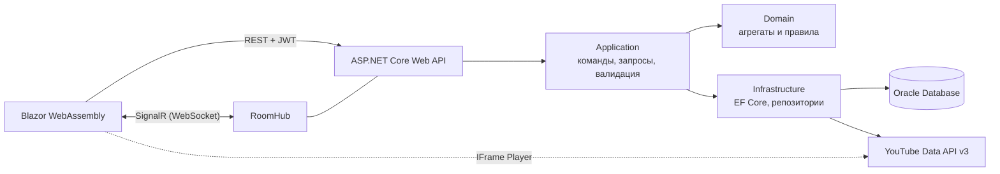

# SoundShare

Сервис совместного прослушивания музыки: участники комнаты слушают одну очередь синхронно, добавляют треки и голосуют, а очередь перестраивается в реальном времени.

> Статус: готова версия для защиты — схема Oracle (V001–V009), REST API с SignalR, клиент Blazor WebAssembly, 274 автотеста (покрытие 86,9 %), UI-тесты Playwright, коллекция Postman, нагрузочные тесты NBomber.

## Назначение и пользователи

- **Проблема.** В компании музыку обычно выбирает один человек, остальные на выбор не влияют.
- **Решение.** Комната с общей очередью: трек с большим числом голосов играет раньше, трек с рейтингом −5 удаляется сам, большинство может пропустить играющий трек.
- **Пользователи.** Компании друзей, офисы, стримеры и их зрители; администратор платформы управляет пользователями, каталогом и журналом действий.

## Стек

| Слой | Технологии |
|---|---|
| Backend | C#, .NET 10 (LTS), ASP.NET Core Web API, SignalR |
| Доступ к данным | Entity Framework Core (Oracle.EntityFrameworkCore), SQL-миграции |
| База данных | Oracle Database 23ai Free; скрипты совместимы с 19c/21c |
| Клиент | Blazor WebAssembly |
| Безопасность и валидация | JwtBearer (Access/Refresh), ASP.NET Core Identity PasswordHasher, FluentValidation, Rate Limiting |
| Документация API | OpenAPI, Scalar |
| Тестирование | xUnit, Shouldly, NSubstitute, Testcontainers, WireMock.Net, Playwright, NBomber |
| Инфраструктура | Docker, Docker Compose |

## Архитектура



Clean Architecture: зависимости направлены внутрь, Domain не зависит ни от чего.

## Модули

| Модуль | Ответственность | Код |
|---|---|---|
| Auth | Регистрация, вход, ротация Access/Refresh токенов | `AuthService`, `AuthController` |
| Users | Управление пользователями и ролями Admin/User, блокировка, удаление аккаунта | `UserAdminService`, `UsersController`, `AdminUsersController` |
| Audit | Журнал действий: HTTP, SignalR, изменения сущностей | `AuditMiddleware`, `AuditBuffer`, `AuditWriterService`, `AdminAuditController` |
| Rooms | Комнаты, участники, роли в комнате, инвайт-коды, баны | `RoomService`, `RoomsController` |
| Queue | Очередь треков, закрепление, голосование, пропуск, автоудаление | `QueueService`, `QueueRules`, `QueueController` |
| Playback | Синхронизация воспроизведения, автопереход к следующему треку | `PlaybackWorker`, `RoomHub` |
| Catalog | Треки и исполнители, поиск, импорт из YouTube | `CatalogService`, `PlaylistService`, `YouTubeTrackSource`, `CatalogController` |

## Точки интеграции

| Система | Назначение |
|---|---|
| Oracle Database | Хранение данных; схема `SOUNDSHARE`, приложение подключается как `SOUNDSHARE_APP` |
| YouTube Data API v3 | Поиск треков и их метаданных |
| YouTube IFrame Player | Воспроизведение на клиенте |
| SignalR | Рассылка изменений очереди участникам комнаты |
| Файловая система | Структурированные логи (Serilog) — не реализовано, см. DEF-012 |

## Запуск

Требуется Docker Desktop.

1. Создайте файл окружения и задайте пароли:
   ```bash
   cp .env.example .env
   ```
2. Поднимите Oracle:
   ```bash
   docker compose up -d
   ```
   Первый запуск занимает несколько минут; дождитесь статуса `healthy` в `docker compose ps`.
3. Создайте пользователей БД (запросит пароль `SYSTEM` и пароли из `.env`):
   ```bash
   docker cp db/bootstrap/01_create_users.sql soundshare-oracle:/tmp/
   docker exec -it soundshare-oracle sqlplus system@//localhost:1521/FREEPDB1 @/tmp/01_create_users.sql
   ```
4. Примените миграции, загрузите демо-данные и проверьте ограничения схемы (под пользователем `SOUNDSHARE`, пароль из `.env`):
   ```bash
   docker cp db soundshare-oracle:/tmp/db
   docker exec -it -w /tmp/db -e NLS_LANG=AMERICAN_AMERICA.AL32UTF8 soundshare-oracle sqlplus soundshare@//localhost:1521/FREEPDB1 @apply_migrations.sql
   docker exec -it -w /tmp/db soundshare-oracle sqlplus soundshare@//localhost:1521/FREEPDB1 @seed/demo.sql
   docker exec -it -w /tmp/db soundshare-oracle sqlplus soundshare@//localhost:1521/FREEPDB1 @tests/constraints_test.sql
   ```
   Пересоздать схему с нуля: `@reset.sql`, затем снова `@apply_migrations.sql`.

5. Запустите API (строка подключения и ключ подписи JWT передаются через переменные окружения, ключ — не короче 32 символов):
   ```bash
   export ConnectionStrings__SoundShare="User Id=SOUNDSHARE_APP;Password=<пароль из .env>;Data Source=localhost:1521/FREEPDB1"
   export Jwt__SigningKey="<случайная строка от 32 символов>"
   dotnet run --project src/SoundShare.WebApi
   ```
   - интерактивная документация API: http://localhost:5290/scalar
   - проверки состояния: `/health/live`, `/health/ready`
   - юнит-тесты: `dotnet test`

Все демо-пользователи (`admin`, `user_owner`, `user_mod`, `user_1` …) имеют пароль `Demo_Pass1`.

С хоста база доступна на `localhost:${ORACLE_PORT}` (по умолчанию 1521), сервис `FREEPDB1`.

Проверка совместимости с Oracle 21c:
```bash
docker compose --profile compat up -d oracle-xe21
```

## Структура репозитория

```
db/
  bootstrap/      создание пользователей БД
  migrations/     версионированные скрипты схемы V001–V009 (таблицы, ключи, индексы, права, триггеры аудита)
  seed/           демо-данные (demo.sql) и объёмные данные для замеров (volume/)
  queries/        DML, SELECT и запросы журнала (этапы 4–6)
  explain/        замеры планов выполнения до и после индексов (этап 7)
  tests/          тесты ограничений схемы, SQL-проверки прогона тест-кейсов
  reset.sql, apply_migrations.sql
docs/             ТЗ, модель данных, отчёты этапов, требования, тестовая документация
src/
  SoundShare.Domain           сущности и бизнес-правила
  SoundShare.Application      сервисы сценариев, DTO, валидация, интерфейсы репозиториев
  SoundShare.Infrastructure   EF Core + Oracle, JWT, YouTube, аудит, фоновое воспроизведение
  SoundShare.WebApi           контроллеры, middleware, SignalR-хаб; раздаёт клиент
  SoundShare.Client           клиент Blazor WebAssembly
tests/
  SoundShare.Domain.UnitTests        модульные тесты домена
  SoundShare.Application.UnitTests   модульные тесты сервисов с моками NSubstitute
  SoundShare.IntegrationTests        Oracle в Testcontainers, WireMock, сценарии через HTTP
  SoundShare.UiTests                 Playwright, Page Object, Chrome/Edge/Firefox
  SoundShare.LoadTests               NBomber
  postman/                           коллекция Postman и окружение
```

## Тестирование

```bash
dotnet test tests/SoundShare.Domain.UnitTests
dotnet test tests/SoundShare.Application.UnitTests
dotnet test tests/SoundShare.IntegrationTests
```

Интеграционным тестам нужен Docker. UI-тестам, коллекции Postman и нагрузочным тестам нужен запущенный API на демо-данных — команды запуска есть в соответствующих отчётах (раздел «Документация»).

## Документация

- [Дорожная карта и статус](docs/00-roadmap.md) · [Техническое задание](docs/01-technical-specification.md) · [Модель данных](docs/02-data-model.md) · [Контракт REST API](docs/api/endpoints.md)
- Этапы БД: [DML](docs/04-dml.md) · [SELECT](docs/05-select.md) · [журнал и макеты](docs/06-audit-and-ui.md) · [индексы](docs/07-index-report.md) · [руководство пользователя](docs/08-user-manual.md)
- Требования: [варианты использования](docs/requirements/use-cases.md) · [диаграммы состояний](docs/requirements/state-diagrams.md) · [матрица верификации](docs/requirements/verification-matrix.md) · [дефекты](ISSUES.md)
- Тестирование: [план](docs/testing/test-plan.md) · [чек-лист](docs/testing/checklist.md) · [тест-кейсы](docs/testing/test-cases.md) · [прогон тест-кейсов](docs/testing/test-run-2026-10-20.md) · [автотесты](docs/testing/autotests.md) · [API (Postman)](docs/testing/api-tests.md) · [безопасность](docs/testing/security-checks.md) · [UI-тесты](docs/testing/ui-tests.md) · [вёрстка и браузеры](docs/testing/ui-compat.md) · [план нагрузки](docs/testing/load-test-plan.md) · [отчёт о нагрузке](docs/testing/load-test-report.md) · [статический анализ](docs/testing/lint-report.md) · [трассируемость](docs/testing/traceability-matrix.md) · [подготовка к защите ВПО](docs/defense-vpo.md)
