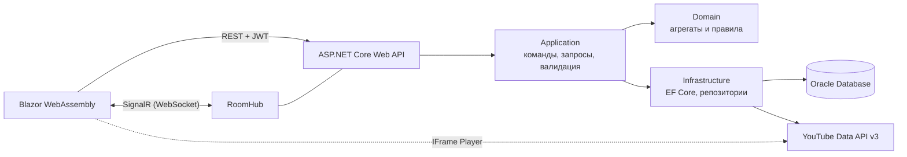

# SoundShare

Сервис совместного прослушивания музыки: участники комнаты слушают одну очередь синхронно, добавляют треки и голосуют, а очередь перестраивается в реальном времени.

> Статус: в разработке. Готовы ТЗ, модель данных и схема Oracle с демо-данными и тестами ограничений; следующий шаг — backend.

## Назначение и пользователи

- **Проблема.** В компании музыку обычно выбирает один человек, остальные на выбор не влияют.
- **Решение.** Комната с общей очередью: трек с большим числом голосов играет раньше, трек с рейтингом −5 удаляется сам, большинство может пропустить играющий трек.
- **Пользователи.** Компании друзей, офисы, стримеры и их зрители; администратор платформы управляет пользователями, каталогом и журналом действий.

## Стек

| Слой | Технологии |
|---|---|
| Backend | C#, .NET 10 (LTS), ASP.NET Core Web API, SignalR |
| Доступ к данным | Entity Framework Core (Oracle.EntityFrameworkCore), SQL-миграции |
| База данных | Oracle Database 23ai Free; скрипты совместимы с 19c/21c |
| Клиент | Blazor WebAssembly |
| Качество | FluentValidation, AutoMapper, JwtBearer, xUnit, NSubstitute, Testcontainers, WireMock.Net, Playwright, NBomber |
| Инфраструктура | Docker, Docker Compose |

## Архитектура



Clean Architecture: зависимости направлены внутрь, Domain не зависит ни от чего.

## Модули

| Модуль | Ответственность |
|---|---|
| Auth | Регистрация, вход, ротация Access/Refresh токенов |
| Users | Управление пользователями и ролями Admin/User, блокировка, удаление аккаунта |
| Audit | Журнал действий: HTTP, SignalR, изменения сущностей |
| Rooms | Комнаты, участники, роли в комнате, инвайт-коды, баны |
| Queue | Очередь треков, закрепление, голосование, пропуск, автоудаление |
| Playback | Синхронизация воспроизведения, автопереход к следующему треку |
| Catalog | Треки и исполнители, поиск, импорт из YouTube |

## Точки интеграции

| Система | Назначение |
|---|---|
| Oracle Database | Хранение данных; схема `SOUNDSHARE`, приложение подключается как `SOUNDSHARE_APP` |
| YouTube Data API v3 | Поиск треков и их метаданных |
| YouTube IFrame Player | Воспроизведение на клиенте |
| SignalR | Рассылка изменений очереди участникам комнаты |
| Файловая система | Структурированные логи (Serilog) |

## Запуск

Требуется Docker Desktop.

1. Создайте файл окружения и задайте пароли:
   ```bash
   cp .env.example .env
   ```
2. Поднимите Oracle:
   ```bash
   docker compose up -d
   ```
   Первый запуск занимает несколько минут; дождитесь статуса `healthy` в `docker compose ps`.
3. Создайте пользователей БД (запросит пароль `SYSTEM` и пароли из `.env`):
   ```bash
   docker cp db/bootstrap/01_create_users.sql soundshare-oracle:/tmp/
   docker exec -it soundshare-oracle sqlplus system@//localhost:1521/FREEPDB1 @/tmp/01_create_users.sql
   ```
4. Примените миграции, загрузите демо-данные и проверьте ограничения схемы (под пользователем `SOUNDSHARE`, пароль из `.env`):
   ```bash
   docker cp db soundshare-oracle:/tmp/db
   docker exec -it -w /tmp/db -e NLS_LANG=AMERICAN_AMERICA.AL32UTF8 soundshare-oracle sqlplus soundshare@//localhost:1521/FREEPDB1 @apply_migrations.sql
   docker exec -it -w /tmp/db soundshare-oracle sqlplus soundshare@//localhost:1521/FREEPDB1 @seed/demo.sql
   docker exec -it -w /tmp/db soundshare-oracle sqlplus soundshare@//localhost:1521/FREEPDB1 @tests/constraints_test.sql
   ```
   Пересоздать схему с нуля: `@reset.sql`, затем снова `@apply_migrations.sql`.

Все демо-пользователи (`admin`, `user_owner`, `user_mod`, `user_1` …) имеют пароль `Demo_Pass1`.

С хоста база доступна на `localhost:${ORACLE_PORT}` (по умолчанию 1521), сервис `FREEPDB1`.

Проверка совместимости с Oracle 21c:
```bash
docker compose --profile compat up -d oracle-xe21
```

## Структура репозитория

```
db/
  bootstrap/    создание пользователей БД
  migrations/   версионированные скрипты схемы V001–V006
  seed/         демо-данные для сценария защиты
  tests/        тесты ограничений схемы (PASS/FAIL)
  reset.sql, apply_migrations.sql
docs/           ТЗ, модель данных, требования, тестовая документация
```

## Документация

- [Техническое задание](docs/01-technical-specification.md)
- [Модель данных](docs/02-data-model.md)
- [Дорожная карта](docs/00-roadmap.md)
- [Контракт REST API](docs/api/endpoints.md)
- Требования: [варианты использования](docs/requirements/use-cases.md) · [диаграммы состояний](docs/requirements/state-diagrams.md) · [матрица верификации](docs/requirements/verification-matrix.md)
- Тестирование: [план](docs/testing/test-plan.md) · [чек-лист](docs/testing/checklist.md) · [тест-кейсы](docs/testing/test-cases.md) · [дефекты](ISSUES.md)
