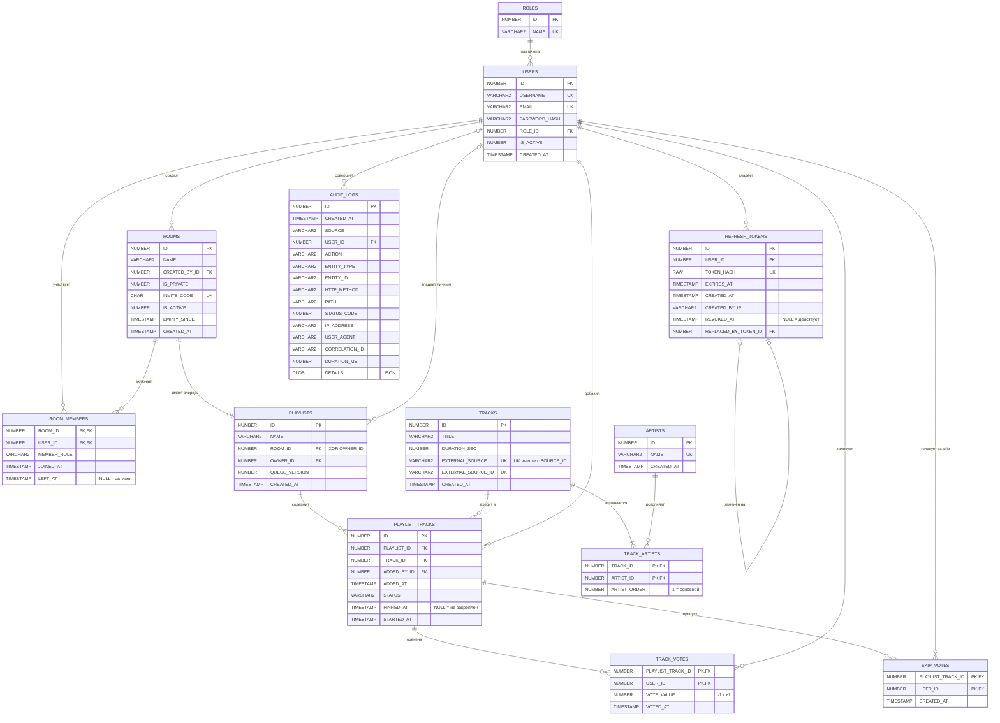

# SoundShare — Модель данных

| | |
|---|---|
| **Документ** | Инфологическая и даталогическая модели базы данных |
| **Версия** | 1.1 |
| **Статус** | Утверждено |
| **Связанные документы** | [Техническое задание](01-technical-specification.md) · [Дорожная карта](00-roadmap.md) |
| **СУБД** | Oracle Database 23ai Free, совместимость с 19c/21c, кодировка `AL32UTF8` |

---

## 0. Уровни моделирования

| Уровень | Вопрос | Артефакт | Раздел |
|---|---|---|---|
| **Инфологический** (концептуальный) | *Какие* факты предметной области храним и как они связаны? | ER-диаграмма, перечень связей с кардинальностью | 1 |
| **Даталогический** (логический) | *Как* эти факты лягут в таблицы конкретной СУБД? | Спецификация таблиц, типов Oracle, ограничений | 3–4 |
| Физический | Где и как хранится на диске (индексы, табличные пространства, IOT, партиции)? | `db/migrations/` |

Документ детализирует раздел 4 технического задания; проектные решения оформлены как DM-01…DM-14.

---

## 1. Инфологическая модель

### 1.1 ER-диаграмма



> Исходник диаграммы хранится в Mermaid и отображается GitHub; для отчёта диаграмма экспортируется в нотацию Crow's Foot.

### 1.2 Перечень связей

| # | Родитель | Потомок | Тип | Обязательность | Смысл |
|---|---|---|---|---|---|
| R1 | ROLES | USERS | 1:N | у пользователя роль обязательна | системная роль |
| R2 | USERS | REFRESH_TOKENS | 1:N | токен без пользователя не существует | сессии входа |
| R3 | REFRESH_TOKENS | REFRESH_TOKENS | 1:0..1 (рекурсивная) | необязательна | цепочка ротации |
| R4 | USERS | ROOMS | 1:N | создатель обязателен | исторический факт «кто создал» |
| R5 | USERS ↔ ROOMS | ROOM_MEMBERS | M:N | — | членство + контекстная роль |
| R6 | ROOMS | PLAYLISTS | 1:0..1 | у комнаты ровно одна очередь (по бизнес-правилу) | очередь комнаты |
| R7 | USERS | PLAYLISTS | 1:N | необязательна | личные плейлисты |
| R6/R7 | — | PLAYLISTS | **исключающая дуга** | ровно одна из R6, R7 | см. DM-03 |
| R8 | PLAYLISTS ↔ TRACKS | PLAYLIST_TRACKS | M:N | — | позиции (дубликаты трека допустимы) |
| R9 | USERS | PLAYLIST_TRACKS | 1:N | обязательна | кто добавил |
| R10 | TRACKS ↔ ARTISTS | TRACK_ARTISTS | M:N | у трека ≥ 1 исполнитель | feat. |
| R11 | PLAYLIST_TRACKS ↔ USERS | TRACK_VOTES | M:N | — | like/dislike |
| R12 | PLAYLIST_TRACKS ↔ USERS | SKIP_VOTES | M:N | — | vote-to-skip |
| R13 | USERS | AUDIT_LOGS | 1:N | необязательна (анонимные/системные события) | журнал |

> **R10, «≥ 1 исполнитель».** Декларативно в Oracle это не выражается: FK обеспечивает «потомок → родитель», но не «у родителя есть хотя бы один потомок». Инвариант держит Domain: агрегат `Track` создаётся только со списком исполнителей.

---

## 2. Ключевые проектные решения (DM-xx)

Формат ADR (Architecture Decision Record): контекст → решение → последствия.

### DM-01. Владелец комнаты: роль в `ROOM_MEMBERS`, а не `ROOMS.OWNER_ID`
- **Контекст.** Владелец мог бы храниться сразу в двух местах: `ROOMS.OWNER_ID` и `ROOM_MEMBERS.MEMBER_ROLE = 'OWNER'`. Два источника истины, при передаче владения (BR-ROOM-05) их нужно синхронно менять.
- **Решение.** Текущий владелец — только участник с `MEMBER_ROLE = 'OWNER'`. Уникальность «не более одного активного Owner на комнату» обеспечивает функциональный индекс (раздел 6). В `ROOMS` остаётся `CREATED_BY_ID`: это **другой, неизменяемый** факт («кто создал»).
- **Последствия.** Передача владения — два `UPDATE` строк `ROOM_MEMBERS` в одной транзакции.

### DM-02. Состояние воспроизведения хранится в `PLAYLIST_TRACKS`
- **Контекст.** Колонка `ROOMS.CURRENT_PLAYLIST_TRACK_ID` дублировала бы `STATUS = 'PLAYING'`. Вдобавок FK `ROOMS → PLAYLIST_TRACKS → PLAYLISTS → ROOMS` образует **цикл**, а с циклическими внешними ключами неудобно работать при вставке и удалении (нужны отложенные ограничения `DEFERRABLE`).
- **Решение.** Из `ROOMS` убираются `CURRENT_PLAYLIST_TRACK_ID` и `PLAYBACK_STARTED_AT`. Текущий трек — позиция со `STATUS = 'PLAYING'`, время начала — `PLAYLIST_TRACKS.STARTED_AT` (факт о самой позиции). Правило «одна играющая позиция на плейлист» задаёт функциональный уникальный индекс.
- **Последствия.** Цикла нет. Бесплатно появляется история воспроизведения (`STARTED_AT` у сыгранных треков) для статистики. Защита автоперехода от двойного срабатывания: `UPDATE ... SET STATUS = 'PLAYED' WHERE ID = :id AND STATUS = 'PLAYING'`. Если затронуто 0 строк, другой обработчик успел раньше.

### DM-03. `PLAYLISTS`: исключающая дуга (exclusive arc)
- **Решение.** Плейлист принадлежит **либо** комнате (`ROOM_ID`), **либо** пользователю (`OWNER_ID`), ровно одно из двух:
  `CHECK ((ROOM_ID IS NOT NULL AND OWNER_ID IS NULL) OR (ROOM_ID IS NULL AND OWNER_ID IS NOT NULL))`.
  `UNIQUE (ROOM_ID)`: одна очередь на комнату. Строки с `NULL` в индекс не попадают, поэтому личные плейлисты не конфликтуют.
- **Почему не две таблицы.** `ROOM_QUEUES` и `USER_PLAYLISTS` с одинаковой структурой потребовали бы двух таблиц позиций, а UC-12 (копирование очереди) стал бы сложнее.

### DM-04. Nullable-отметка времени вместо пары «флаг + время»
- **Контекст.** Флага `IS_PINNED NUMBER(1)` недостаточно: для порядка закреплённых нужен ещё `PINNED_AT`. Тогда `ID → PINNED_AT → IS_PINNED`: **транзитивная зависимость, нарушение 3NF**. Возможна и аномалия: `IS_PINNED = 0`, а `PINNED_AT` заполнен.
- **Решение.** Хранится только `PINNED_AT` (`NULL` = не закреплён). Тот же принцип для `REVOKED_AT`, `LEFT_AT`, `EMPTY_SINCE`. В C# — вычисляемое свойство `bool IsPinned => PinnedAt is not null;` без маппинга в колонку.
- **Где флаг `NUMBER(1)` уместен.** Если у состояния нет сопутствующих данных: `IS_ACTIVE`, `IS_PRIVATE`. Требование ORA-2 демонстрируется на них.
- По той же причине из `TRACK_ARTISTS` убран `IS_PRIMARY`: основной исполнитель — `ARTIST_ORDER = 1`.

### DM-05. Ключи: суррогатные для сущностей, составные для ассоциаций
- **Сущности** (USERS, TRACKS, ROOMS…): `NUMBER(19) GENERATED ALWAYS AS IDENTITY`, по ORA-3.
- **Чистые ассоциации** (TRACK_ARTISTS, ROOM_MEMBERS, TRACK_VOTES, SKIP_VOTES): **составной PK** из двух FK. Суррогат здесь лишний: всё равно понадобился бы `UNIQUE` по той же паре, то есть второй индекс без пользы. `MERGE` голоса (BR-VOTE-03) работает именно по этому PK.
- **Исключение — `ROLES`.** Статический справочник с фиксированными `ID` (1 = Admin, 2 = User) **без identity**. Причина: EF Core `HasData` требует явных значений ключа, а `GENERATED ALWAYS` запрещает их вставку (`ORA-32795: cannot insert into a generated always identity column`).
- **`PLAYLIST_TRACKS` — суррогат.** Это не чистая ассоциация: пара (PLAYLIST_ID, TRACK_ID) может повторяться, и на позицию ссылаются голоса.

### DM-06. Перечисления: `CHECK` для закрытых наборов, справочник для открытых
- `MEMBER_ROLE`, `STATUS`, `EXTERNAL_SOURCE`, `AUDIT_LOGS.SOURCE` — закрытые наборы, жёстко связанные с кодом (`enum` в Domain). Это `VARCHAR2` + `CHECK (... IN (...))`, в EF — `HasConversion<string>()`. Строки, а не числа: читаемость в SQL и устойчивость к перестановке членов `enum`.
- `ROLES` — справочник (требование ТЗ). Роль попадает в JWT-claim и потенциально расширяется администратором.
- Код перечисления — атомарное значение, а не транзитивная зависимость, поэтому 3NF не нарушается.

### DM-07. `AUDIT_LOGS`: полиморфная ссылка без FK
`ENTITY_TYPE` + `ENTITY_ID` указывают на запись **любой** таблицы, поэтому FK объявить невозможно, и это осознанно: журнал обязан пережить удаление объекта. FK есть только на `USER_ID` (`ON DELETE SET NULL`). `ENTITY_ID` имеет тип `VARCHAR2`, чтобы вмещать и составные ключи (`"12:345"`).

### DM-08. Инвайт-код есть у каждой комнаты
`INVITE_CODE NOT NULL UNIQUE` генерируется при создании любой комнаты. `IS_PRIVATE` отвечает за другое: видна ли комната в поиске. Это два независимых факта, функциональной зависимости между ними нет. Бонус: ссылкой-приглашением можно поделиться и для публичной комнаты.

### DM-09. Лимиты — конфигурация, а не колонки (YAGNI)
100 участников и 3 трека — глобальные правила (`RoomOptions`), а не атрибуты комнаты. Колонка `MAX_MEMBERS` не вводится, пока нет требования настраивать лимит для каждой комнаты.

### DM-10. `PLAYLISTS.QUEUE_VERSION`
Монотонный номер версии очереди (FR-RT, принцип 4) увеличивается при каждом изменении. Он же служит **токеном оптимистичной конкурентности** EF Core (`IsConcurrencyToken()`). В Oracle нет `rowversion`, как в SQL Server, поэтому версию явно увеличивает код.

### DM-11. Kick = бан (`ROOM_MEMBERS.BANNED_UNTIL`)
- `Kick(userId, duration)` одной транзакцией ставит `LEFT_AT = UTC_NOW` и `BANNED_UNTIL`. `JoinRoom` отклоняет вход при `BANNED_UNTIL > UTC_NOW`. «Реанимация» строки при повторном входе (раздел 4.8) возможна только после истечения бана.
- Иерархия: кикнуть можно только участника с **меньшей** ролью (Moderator → Contributor, Owner → любой). Admin — override-политика.
- ⚠ Бессрочный бан задаётся **явной константой** `9999-12-31 00:00:00`, а не `DateTime.MaxValue`. У `DateTime.MaxValue` 7 знаков дробных секунд (`.9999999`), а `TIMESTAMP(6)` округлит значение до 6 знаков, то есть до 10000 года, и получится ошибка `ORA-01841`.

### DM-12. Ручная сортировка личных плейлистов (`PLAYLIST_TRACKS.POSITION`)
- `POSITION` заполнен у позиций личных плейлистов и равен `NULL` у очереди комнаты. Правило «заполнен ⇔ плейлист личный» зависит от **другой таблицы** (`PLAYLISTS.OWNER_ID`), а `CHECK` в Oracle не может ссылаться на другие таблицы. Поэтому это межтабличный инвариант Domain-слоя.
- ⚠ **Ловушка Oracle.** Обычный `UNIQUE (PLAYLIST_ID, POSITION)` сломает очередь комнаты. Строки, у которых в ключе `NULL` *хотя бы в одной* колонке (но не во всех), Oracle индексирует, и две строки `(5, NULL)` и `(5, NULL)` для него **дубликаты** (`ORA-00001`). Нужен функциональный индекс, исключающий строки с `POSITION IS NULL` целиком (раздел 6).
- Перестановка позиций без временного нарушения уникальности решается в DML-запросах (этап 4).

### DM-13. Удаление аккаунта = анонимизация
- В одной транзакции: `IS_ACTIVE = 0`; `USERNAME = 'deleted_<id>'` (формат проходит общий regex и уникален благодаря ID); `EMAIL = 'deleted_<id>@deleted.invalid'` (домен `.invalid` зарезервирован RFC 2606); `PASSWORD_HASH` — заведомо невалидный маркер (не пустая строка: `''` в Oracle = `NULL` → `ORA-01400`); отзыв всех refresh-токенов; выход из активной комнаты с передачей владения (BR-ROOM-05).
- **`AUDIT_LOGS.IP_ADDRESS`, `USER_AGENT`, `DETAILS` — тоже персональные данные** по GDPR. Но у прикладного пользователя БД нет права `UPDATE` на `AUDIT_LOGS` (FR-AUD-05). Решение: хранимая процедура схемы-владельца с правами определителя (*definer's rights*), а приложению выдаётся только `EXECUTE`. Приложение может обезличить записи аудита, но не может их произвольно править.
- Ограничение stateless JWT: выданный Access Token живёт до 15 мин (FR-AUTH-08). Активные SignalR-соединения пользователя принудительно закрываются.

### DM-14. Обложка трека не хранится
- `THUMBNAIL_URL` однозначно вычисляется из ID видео: `https://i.ytimg.com/vi/{EXTERNAL_SOURCE_ID}/hqdefault.jpg`. Хранение даёт транзитивную зависимость `ID → EXTERNAL_SOURCE_ID → THUMBNAIL_URL` (нарушение 3NF) и риск рассинхронизации. URL строит приложение (свойство DTO).
- Пустые и состоящие из пробелов названия запрещены через `CHECK (TRIM(x) IS NOT NULL)`: в Oracle `TRIM('   ')` возвращает `NULL`.

---

## 3. Соглашения даталогической модели

| Аспект | Правило |
|---|---|
| Идентификаторы | `UPPER_SNAKE_CASE`, ≤ 30 символов, без зарезервированных слов (`USER`, `DATE`, `LEVEL`, `SIZE`, `COMMENT`…; полный список — `V$RESERVED_WORDS`). Поэтому `VOTE_VALUE`, а не `VALUE`. |
| Суррогатный ключ | `ID NUMBER(19) GENERATED ALWAYS AS IDENTITY` ↔ `long` |
| FK-колонка | `<СУЩНОСТЬ>_ID`, тип совпадает с PK родителя |
| Строки | `VARCHAR2(n CHAR)` ↔ `string` |
| Булево | `NUMBER(1) NOT NULL` + `CHECK (X IN (0,1))` ↔ `bool` |
| Время | `TIMESTAMP(6)`, **всегда UTC**, `DEFAULT SYS_EXTRACT_UTC(SYSTIMESTAMP)` ↔ `DateTime` (Kind = Utc через ValueConverter) |
| Бинарное | `RAW(n)` ↔ `byte[]` |
| JSON | `CLOB CHECK (X IS JSON)` ↔ `string` (переход на нативный `JSON` 23ai — после проверки поддержки провайдером) |
| Ограничения | `PK_<T>`, `FK_<T>_<REF>`, `UQ_<T>_<COLS>`, `CK_<T>_<COL>`, `UX_` (уникальный индекс), `IX_` (индекс) |

---

## 4. Даталогическая модель: спецификация таблиц

Обозначения: **NN** — NOT NULL, **D** — DEFAULT. `UTC_NOW` = `SYS_EXTRACT_UTC(SYSTIMESTAMP)`.

### 4.1 `ROLES` — справочник системных ролей
| Колонка | Тип Oracle | NN | D | Ограничения | C# |
|---|---|:-:|---|---|---|
| ID | NUMBER(5) | ✔ | — | PK (без identity, DM-05) | `int` |
| NAME | VARCHAR2(32 CHAR) | ✔ | — | UQ | `string` |

Seed: `(1, 'Admin')`, `(2, 'User')`.

### 4.2 `USERS`
| Колонка | Тип | NN | D | Ограничения | C# |
|---|---|:-:|---|---|---|
| ID | NUMBER(19) IDENTITY | ✔ | — | PK | `long` |
| USERNAME | VARCHAR2(32 CHAR) | ✔ | — | UX по `UPPER(USERNAME)` | `string` |
| EMAIL | VARCHAR2(254 CHAR) | ✔ | — | UX по `UPPER(EMAIL)` | `string` |
| PASSWORD_HASH | VARCHAR2(256) | ✔ | — | — | `string` |
| ROLE_ID | NUMBER(5) | ✔ | 2 | FK → ROLES | `int` |
| IS_ACTIVE | NUMBER(1) | ✔ | 1 | CK IN (0,1) | `bool` |
| CREATED_AT | TIMESTAMP(6) | ✔ | UTC_NOW | — | `DateTime` |

Уникальность без учёта регистра — **функциональными** индексами: `Vasya` и `vasya` не должны оказаться двумя аккаунтами. 254 — максимальная длина email по RFC 5321.

### 4.3 `REFRESH_TOKENS`
| Колонка | Тип | NN | D | Ограничения | C# |
|---|---|:-:|---|---|---|
| ID | NUMBER(19) IDENTITY | ✔ | — | PK | `long` |
| USER_ID | NUMBER(19) | ✔ | — | FK → USERS **ON DELETE CASCADE** | `long` |
| TOKEN_HASH | RAW(32) | ✔ | — | UQ | `byte[]` |
| EXPIRES_AT | TIMESTAMP(6) | ✔ | — | CK `EXPIRES_AT > CREATED_AT` | `DateTime` |
| CREATED_AT | TIMESTAMP(6) | ✔ | UTC_NOW | — | `DateTime` |
| CREATED_BY_IP | VARCHAR2(45) | | — | — (45 = макс. длина IPv6 в тексте) | `string?` |
| REVOKED_AT | TIMESTAMP(6) | | — | — | `DateTime?` |
| REPLACED_BY_TOKEN_ID | NUMBER(19) | | — | FK → REFRESH_TOKENS **ON DELETE SET NULL** | `long?` |

`RAW(32)` = ровно 32 байта SHA-256. В hex-строке было бы 64 символа: вдвое больше места в таблице и индексе.

### 4.4 `ARTISTS`
| Колонка | Тип | NN | D | Ограничения | C# |
|---|---|:-:|---|---|---|
| ID | NUMBER(19) IDENTITY | ✔ | — | PK | `long` |
| NAME | VARCHAR2(200 CHAR) | ✔ | — | UX по `UPPER(NAME)` | `string` |
| CREATED_AT | TIMESTAMP(6) | ✔ | UTC_NOW | — | `DateTime` |

> Компромисс: реальные исполнители бывают тёзками, но при эвристическом разборе названий с YouTube (BR-TRK-02) уникальность имени — единственный способ избежать сотен дублей «Drake». Фиксируем как допущение v1.

### 4.5 `TRACKS`
| Колонка | Тип | NN | D | Ограничения | C# |
|---|---|:-:|---|---|---|
| ID | NUMBER(19) IDENTITY | ✔ | — | PK | `long` |
| TITLE | VARCHAR2(300 CHAR) | ✔ | — | CK `TRIM(TITLE) IS NOT NULL` | `string` |
| DURATION_SEC | NUMBER(6) | ✔ | — | CK `> 0` (исключает live-трансляции с нулевой длительностью) | `int` |
| EXTERNAL_SOURCE | VARCHAR2(16) | ✔ | `'YOUTUBE'` | CK IN ('YOUTUBE') | `enum TrackSource` |
| EXTERNAL_SOURCE_ID | VARCHAR2(64) | ✔ | — | UQ (EXTERNAL_SOURCE, EXTERNAL_SOURCE_ID); для YouTube CK `^[A-Za-z0-9_-]{11}$` | `string` |
| CREATED_AT | TIMESTAMP(6) | ✔ | UTC_NOW | — | `DateTime` |

Обложка не хранится (DM-14): её URL вычисляется из ID видео.

### 4.6 `TRACK_ARTISTS`
| Колонка | Тип | NN | D | Ограничения | C# |
|---|---|:-:|---|---|---|
| TRACK_ID | NUMBER(19) | ✔ | — | PK(1), FK → TRACKS **ON DELETE CASCADE** | `long` |
| ARTIST_ID | NUMBER(19) | ✔ | — | PK(2), FK → ARTISTS | `long` |
| ARTIST_ORDER | NUMBER(2) | ✔ | — | CK `>= 1`; UQ (TRACK_ID, ARTIST_ORDER) | `int` |

### 4.7 `ROOMS`
| Колонка | Тип | NN | D | Ограничения | C# |
|---|---|:-:|---|---|---|
| ID | NUMBER(19) IDENTITY | ✔ | — | PK | `long` |
| NAME | VARCHAR2(100 CHAR) | ✔ | — | CK `TRIM(NAME) IS NOT NULL` | `string` |
| CREATED_BY_ID | NUMBER(19) | ✔ | — | FK → USERS | `long` |
| IS_PRIVATE | NUMBER(1) | ✔ | 0 | CK IN (0,1) | `bool` |
| INVITE_CODE | CHAR(6 BYTE) | ✔ | — | UQ; CK `REGEXP_LIKE(INVITE_CODE, '^[A-HJ-NP-Z2-9]{6}$', 'c')` | `string` |
| IS_ACTIVE | NUMBER(1) | ✔ | 1 | CK IN (0,1) | `bool` |
| EMPTY_SINCE | TIMESTAMP(6) | | — | — | `DateTime?` |
| CREATED_AT | TIMESTAMP(6) | ✔ | UTC_NOW | — | `DateTime` |

Регулярное выражение — ровно алфавит из BR-ROOM-02: `A–Z` без `I` и `O` (24 буквы) + `2–9` (8 цифр) = 32 символа.

### 4.8 `ROOM_MEMBERS`
| Колонка | Тип | NN | D | Ограничения | C# |
|---|---|:-:|---|---|---|
| ROOM_ID | NUMBER(19) | ✔ | — | PK(1), FK → ROOMS | `long` |
| USER_ID | NUMBER(19) | ✔ | — | PK(2), FK → USERS | `long` |
| MEMBER_ROLE | VARCHAR2(16) | ✔ | `'CONTRIBUTOR'` | CK IN ('OWNER','MODERATOR','CONTRIBUTOR') | `enum RoomRole` |
| JOINED_AT | TIMESTAMP(6) | ✔ | UTC_NOW | — | `DateTime` |
| LEFT_AT | TIMESTAMP(6) | | — | CK `LEFT_AT IS NULL OR LEFT_AT >= JOINED_AT` | `DateTime?` |
| BANNED_UNTIL | TIMESTAMP(6) | | — | CK `BANNED_UNTIL IS NULL OR (LEFT_AT IS NOT NULL AND BANNED_UNTIL > LEFT_AT)`: забаненный не может быть активным, бан заканчивается позже исключения | `DateTime?` |

Бан (DM-11): активен, если `BANNED_UNTIL > UTC_NOW`. Бессрочный бан — константа `9999-12-31 00:00:00`.

При повторном входе существующая строка «реанимируется»: `LEFT_AT = NULL`, `JOINED_AT = UTC_NOW`, `MEMBER_ROLE = 'CONTRIBUTOR'`. Поэтому PK по паре сохраняется, а очередь передачи владения (BR-ROOM-05) считается от *текущей* сессии участника.

### 4.9 `PLAYLISTS`
| Колонка | Тип | NN | D | Ограничения | C# |
|---|---|:-:|---|---|---|
| ID | NUMBER(19) IDENTITY | ✔ | — | PK | `long` |
| NAME | VARCHAR2(100 CHAR) | ✔ | — | CK `TRIM(NAME) IS NOT NULL` | `string` |
| ROOM_ID | NUMBER(19) | | — | FK → ROOMS; UQ | `long?` |
| OWNER_ID | NUMBER(19) | | — | FK → USERS | `long?` |
| QUEUE_VERSION | NUMBER(19) | ✔ | 0 | CK `>= 0`; concurrency token (DM-10) | `long` |
| CREATED_AT | TIMESTAMP(6) | ✔ | UTC_NOW | — | `DateTime` |

Табличное ограничение `CK_PLAYLISTS_ARC` — исключающая дуга (DM-03).

### 4.10 `PLAYLIST_TRACKS`
| Колонка | Тип | NN | D | Ограничения | C# |
|---|---|:-:|---|---|---|
| ID | NUMBER(19) IDENTITY | ✔ | — | PK | `long` |
| PLAYLIST_ID | NUMBER(19) | ✔ | — | FK → PLAYLISTS **ON DELETE CASCADE** | `long` |
| TRACK_ID | NUMBER(19) | ✔ | — | FK → TRACKS | `long` |
| ADDED_BY_ID | NUMBER(19) | ✔ | — | FK → USERS | `long` |
| ADDED_AT | TIMESTAMP(6) | ✔ | UTC_NOW | — | `DateTime` |
| STATUS | VARCHAR2(16) | ✔ | `'QUEUED'` | CK IN ('QUEUED','PLAYING','PLAYED','SKIPPED','REMOVED','AUTO_REMOVED') | `enum QueueItemStatus` |
| PINNED_AT | TIMESTAMP(6) | | — | CK `PINNED_AT IS NULL OR PINNED_AT >= ADDED_AT` | `DateTime?` |
| STARTED_AT | TIMESTAMP(6) | | — | CK: заполнено ровно у `PLAYING`, `PLAYED`, `SKIPPED`; пусто у `QUEUED`, `REMOVED`, `AUTO_REMOVED` | `DateTime?` |
| POSITION | NUMBER(6) | | — | CK `POSITION IS NULL OR POSITION >= 1`; уникальность в плейлисте — DM-12 | `int?` |

Жизненный цикл `STATUS`:
```
QUEUED ──► PLAYING ──► PLAYED      (дослушан, автопереход)
   │          └──────► SKIPPED     (vote-to-skip / модератор)
   ├──► REMOVED                    (удалил модератор/автор)
   └──► AUTO_REMOVED               (рейтинг ≤ −5, BR-VOTE-05)
```
Переходы проверяет Domain (метод агрегата, например `QueueItem.Skip()`), а не БД. Конечные автоматы удобнее тестировать в коде.

### 4.11 `TRACK_VOTES`
| Колонка | Тип | NN | D | Ограничения | C# |
|---|---|:-:|---|---|---|
| PLAYLIST_TRACK_ID | NUMBER(19) | ✔ | — | PK(1), FK → PLAYLIST_TRACKS **ON DELETE CASCADE** | `long` |
| USER_ID | NUMBER(19) | ✔ | — | PK(2), FK → USERS | `long` |
| VOTE_VALUE | NUMBER(1) | ✔ | — | CK IN (-1, 1) | `short` / `enum VoteValue` |
| VOTED_AT | TIMESTAMP(6) | ✔ | UTC_NOW | — | `DateTime` |

Значение `0` («снять голос») в таблице не хранится: это `DELETE` (BR-VOTE-03).

### 4.12 `SKIP_VOTES`
| Колонка | Тип | NN | D | Ограничения | C# |
|---|---|:-:|---|---|---|
| PLAYLIST_TRACK_ID | NUMBER(19) | ✔ | — | PK(1), FK → PLAYLIST_TRACKS **ON DELETE CASCADE** | `long` |
| USER_ID | NUMBER(19) | ✔ | — | PK(2), FK → USERS | `long` |
| CREATED_AT | TIMESTAMP(6) | ✔ | UTC_NOW | — | `DateTime` |

### 4.13 `AUDIT_LOGS`
| Колонка | Тип | NN | D | Ограничения | C# |
|---|---|:-:|---|---|---|
| ID | NUMBER(19) IDENTITY | ✔ | — | PK | `long` |
| CREATED_AT | TIMESTAMP(6) | ✔ | UTC_NOW | — | `DateTime` |
| SOURCE | VARCHAR2(8) | ✔ | — | CK IN ('HTTP','HUB','DOMAIN','SYSTEM'); для `HTTP` обязательны метод, путь и код ответа | `enum AuditSource` |
| USER_ID | NUMBER(19) | | — | FK → USERS **ON DELETE SET NULL** | `long?` |
| ACTION | VARCHAR2(64) | ✔ | — | — (`'Room.Join'`, `'Auth.LoginFailed'`…) | `string` |
| ENTITY_TYPE | VARCHAR2(64) | | — | — | `string?` |
| ENTITY_ID | VARCHAR2(64) | | — | — | `string?` |
| HTTP_METHOD | VARCHAR2(10) | | — | — | `string?` |
| PATH | VARCHAR2(512 CHAR) | | — | — | `string?` |
| STATUS_CODE | NUMBER(3) | | — | CK `BETWEEN 100 AND 599` | `int?` |
| IP_ADDRESS | VARCHAR2(45) | | — | — | `string?` |
| USER_AGENT | VARCHAR2(512 CHAR) | | — | — | `string?` |
| CORRELATION_ID | VARCHAR2(64) | | — | — | `string?` |
| DURATION_MS | NUMBER(10) | | — | CK `>= 0` | `int?` |
| DETAILS | CLOB | | — | CK `DETAILS IS JSON STRICT` | `string?` |

HTTP-поля nullable, потому что у записей `SOURCE = 'DOMAIN' / 'SYSTEM'` (например, автозакрытие комнаты фоновой службой) HTTP-контекста нет.

### 4.14 Сводка ссылочных действий

| FK | ON DELETE | Обоснование |
|---|---|---|
| USERS.ROLE_ID → ROLES | NO ACTION | Роль, на которую ссылаются, удалять нельзя |
| REFRESH_TOKENS.USER_ID → USERS | CASCADE | Токены — часть пользователя |
| REFRESH_TOKENS.REPLACED_BY_TOKEN_ID → self | SET NULL | Очистка цепочки не должна ломать ссылки |
| TRACK_ARTISTS.TRACK_ID → TRACKS | CASCADE | Связь — часть трека |
| TRACK_ARTISTS.ARTIST_ID → ARTISTS | NO ACTION | Нельзя удалить исполнителя с треками |
| PLAYLIST_TRACKS.PLAYLIST_ID → PLAYLISTS | CASCADE | Удаление личного плейлиста |
| PLAYLIST_TRACKS.TRACK_ID → TRACKS | NO ACTION | Трек из чьей-то истории не удаляется |
| TRACK_VOTES / SKIP_VOTES → PLAYLIST_TRACKS | CASCADE | Голоса — часть позиции |
| AUDIT_LOGS.USER_ID → USERS | SET NULL | Журнал переживает пользователя |
| Все прочие (ROOMS, ROOM_MEMBERS, …) | NO ACTION | Users и Rooms удаляются мягко (NFR-TX-04) |

> **Oracle internals.** В Oracle есть только `ON DELETE CASCADE` и `ON DELETE SET NULL`. **`ON UPDATE CASCADE` нет вообще**, это аргумент за неизменяемые суррогатные ключи. В EF Core поведение задаётся `OnDelete(DeleteBehavior.Cascade / SetNull / Restrict)`. `Restrict` и `NoAction` дают в Oracle одинаковый DDL.

---

## 5. Нормализация: функциональные зависимости

### 5.1 Минимальное покрытие ФЗ и нормальная форма

| Таблица | Потенциальные ключи | Нетривиальные ФЗ | НФ |
|---|---|---|---|
| ROLES | {ID}, {NAME} | ID → NAME; NAME → ID | BCNF |
| USERS | {ID}, {UPPER(USERNAME)}, {UPPER(EMAIL)} | ID → все атрибуты | BCNF |
| REFRESH_TOKENS | {ID}, {TOKEN_HASH} | ID → все | BCNF |
| ARTISTS | {ID}, {UPPER(NAME)} | ID → все | BCNF |
| TRACKS | {ID}, {EXTERNAL_SOURCE, EXTERNAL_SOURCE_ID} | ID → все; (SOURCE, SOURCE_ID) → все | BCNF |
| TRACK_ARTISTS | {TRACK_ID, ARTIST_ID}, {TRACK_ID, ARTIST_ORDER} | (TRACK, ARTIST) → ORDER; (TRACK, ORDER) → ARTIST | BCNF |
| ROOMS | {ID}, {INVITE_CODE} | ID → все | BCNF |
| ROOM_MEMBERS | {ROOM_ID, USER_ID} | (ROOM, USER) → ROLE, JOINED_AT, LEFT_AT | BCNF |
| PLAYLISTS | {ID} | ID → все; ROOM_ID → все (если NOT NULL) | BCNF |
| PLAYLIST_TRACKS | {ID} | ID → все | BCNF |
| TRACK_VOTES | {PLAYLIST_TRACK_ID, USER_ID} | (PT, USER) → VOTE_VALUE, VOTED_AT | BCNF |
| SKIP_VOTES | {PLAYLIST_TRACK_ID, USER_ID} | (PT, USER) → CREATED_AT | BCNF |
| AUDIT_LOGS | {ID} | ID → все | BCNF |

Все таблицы — в **BCNF** (это строже 3NF: детерминант каждой нетривиальной ФЗ — потенциальный ключ). Многозначных зависимостей нет. Единственная M:N с двумя независимыми фактами могла бы быть «трек ↔ исполнители ↔ жанры», но жанры исключены (BR-TRK-04), поэтому 4NF тоже соблюдена.

### 5.2 Отвергнутые варианты

| Отвергнутый атрибут | Нарушение | Аномалия | Где вместо этого |
|---|---|---|---|
| `USERS.ROLE_NAME` | 3NF: ID → ROLE_ID → ROLE_NAME | Обновление: переименование роли = N строк | `ROLES.NAME` + JOIN |
| `TRACKS.ARTIST_NAMES = 'A, B'` | 1NF: неатомарное значение | Невозможен поиск/индекс по исполнителю | `TRACK_ARTISTS` |
| `TRACKS.ARTIST_ID` | Потеря данных для feat. | — | `TRACK_ARTISTS` |
| `PLAYLIST_TRACKS.SCORE` | Производный атрибут | Рассинхрон со `TRACK_VOTES`, lost update, горячая строка | `SUM(VOTE_VALUE)` |
| `PLAYLIST_TRACKS.IS_PINNED` | 3NF: ID → PINNED_AT → IS_PINNED | Противоречивое состояние | `PINNED_AT IS NOT NULL` (DM-04) |
| `TRACK_ARTISTS.IS_PRIMARY` | 3NF: (T, A) → ORDER → IS_PRIMARY | Два «основных» исполнителя | `ARTIST_ORDER = 1` |
| `ROOMS.OWNER_ID` | Дублирование факта из ROOM_MEMBERS | Расхождение при передаче владения | DM-01 |
| `ROOMS.CURRENT_PLAYLIST_TRACK_ID` | Дублирование `STATUS='PLAYING'` + цикл FK | Два «текущих» трека | DM-02 |
| `ROOMS.MEMBERS_COUNT` | Производный атрибут | Рассинхрон при входе/выходе | `COUNT(*)` |
| `USERS.CURRENT_ROOM_ID` | Дублирование `ROOM_MEMBERS.LEFT_AT IS NULL` | Два источника истины | BR-ROOM-06 |
| `AUDIT_LOGS.USERNAME` | 3NF: USER_ID → USERNAME | Устаревшее имя после переименования | JOIN (а при удалении — `NULL`) |

> **Примечание.** Денормализация — не ошибка, а инструмент, который применяют **после** замеров. Если на этапе 7 `EXPLAIN PLAN` покажет, что `SUM(VOTE_VALUE)` по очереди — узкое место, можно будет обсудить материализованное представление (`MATERIALIZED VIEW ... REFRESH FAST ON COMMIT`). Но не раньше.

---

## 6. Ограничения, которые требуют функциональных индексов

Реализуются в `V003__indexes.sql`. Все они используют одно свойство Oracle B-tree: **строка, у которой все ключевые выражения равны `NULL`, в индекс не попадает**. Через `CASE ... END` получается «частичный уникальный индекс», которого в Oracle нет как отдельной конструкции (в PostgreSQL это `CREATE UNIQUE INDEX ... WHERE ...`).

| Индекс | Выражение | Правило |
|---|---|---|
| `UX_USERS_USERNAME_CI` | `UPPER(USERNAME)` | Уникальность без учёта регистра |
| `UX_USERS_EMAIL_CI` | `UPPER(EMAIL)` | — // — |
| `UX_ARTISTS_NAME_CI` | `UPPER(NAME)` | — // — |
| `UX_RM_ACTIVE_USER` | `CASE WHEN LEFT_AT IS NULL THEN USER_ID END` | Одна активная комната на пользователя (BR-ROOM-06) |
| `UX_RM_ACTIVE_OWNER` | `CASE WHEN LEFT_AT IS NULL AND MEMBER_ROLE = 'OWNER' THEN ROOM_ID END` | Не более одного активного Owner (DM-01) |
| `UX_PT_ONE_PLAYING` | `CASE WHEN STATUS = 'PLAYING' THEN PLAYLIST_ID END` | Одна играющая позиция на очередь (DM-02) |
| `UX_PT_POSITION` | двухколоночный, оба выражения `NULL` при `POSITION IS NULL` | Уникальная позиция в личном плейлисте (DM-12) |

---

## 7. Особенности Oracle и EF Core, учтённые в модели

1. **Пустая строка в Oracle — это `NULL`.** `INSERT ... VALUES ('')` в колонку `NOT NULL` даёт `ORA-01400`. В C# `string.Empty` ≠ `null`, в Oracle они неразличимы. Следствие: валидаторы FluentValidation обязаны отсекать пустые строки (`NotEmpty()`), иначе получим 500 вместо 400.
2. **`VARCHAR2(n)` по умолчанию считается в байтах** (`NLS_LENGTH_SEMANTICS = BYTE`). В `AL32UTF8` кириллица занимает 2 байта, emoji — 4: в `VARCHAR2(100)` поместится лишь 25 emoji. Поэтому везде явно `CHAR`. Жёсткий предел — 4000 **байт** при `MAX_STRING_SIZE = STANDARD`, даже для `CHAR`-семантики.
3. **EF-провайдер Oracle по умолчанию маппит `string` в `NVARCHAR2(2000)`.** Без явной конфигурации (`HasMaxLength` + `HasColumnType("VARCHAR2(100 CHAR)")` или конвенции) схема разойдётся с этим документом. Соответствие маппинга схеме проверяется интеграционным тестом.
4. **`NUMBER(1)` хранит −9…9.** Именно поэтому для булевых колонок обязателен `CHECK IN (0,1)`, а `VOTE_VALUE` умещается в тот же тип.
5. **`SYSTIMESTAMP` возвращает время в часовом поясе ОС сервера БД**, а не UTC. В Docker-образе это обычно UTC, на «живом» сервере — нет. `SYS_EXTRACT_UTC(...)` убирает эту зависимость от окружения.
6. **FK без индекса → блокировка всей дочерней таблицы** (TM-lock, режим Share) при `DELETE` родителя или изменении его ключа. Составной PK `(PLAYLIST_TRACK_ID, USER_ID)` покрывает FK только по **ведущей** колонке. Для `TRACK_VOTES.USER_ID`, `SKIP_VOTES.USER_ID`, `ROOM_MEMBERS.USER_ID`, `TRACK_ARTISTS.ARTIST_ID` нужны отдельные индексы (`V003__indexes.sql`).
7. **Identity под капотом** — это системный `SEQUENCE` (`ISEQ$$_<obj#>`) с кэшем 20 значений. При рестарте инстанса кэш теряется, и в ID появятся «дыры». Это нормально: суррогатный ключ не обязан быть непрерывным.
8. **Кандидаты на IOT** (`ORGANIZATION INDEX`): `TRACK_VOTES`, `SKIP_VOTES`, `TRACK_ARTISTS`. Это узкие таблицы с составным PK, в которых все чтения идут по ключу. IOT хранит строки прямо в B-дереве PK, без отдельной heap-таблицы: минус один индекс и минус переход по ROWID. Решение принимается по результатам `EXPLAIN PLAN`.

---

## 8. Решения по уточняющим вопросам

| Вопрос | Решение |
|---|---|
| Kick — бан? | Да, `BANNED_UNTIL` (DM-11) |
| Порядок личных плейлистов | Ручной, `POSITION` (DM-12) |
| Загрузка плейлиста в очередь | Разрешена всем; треки добавляются по `POSITION`, пока не исчерпан лимит 3 (BR-ROOM-04); ответ — `200` с числом добавленных. Owner/Moderator подчиняются тому же лимиту (настройки лимита на уровне комнаты — v2, DM-09) |
| Удаление аккаунта | Анонимизация (DM-13) |
