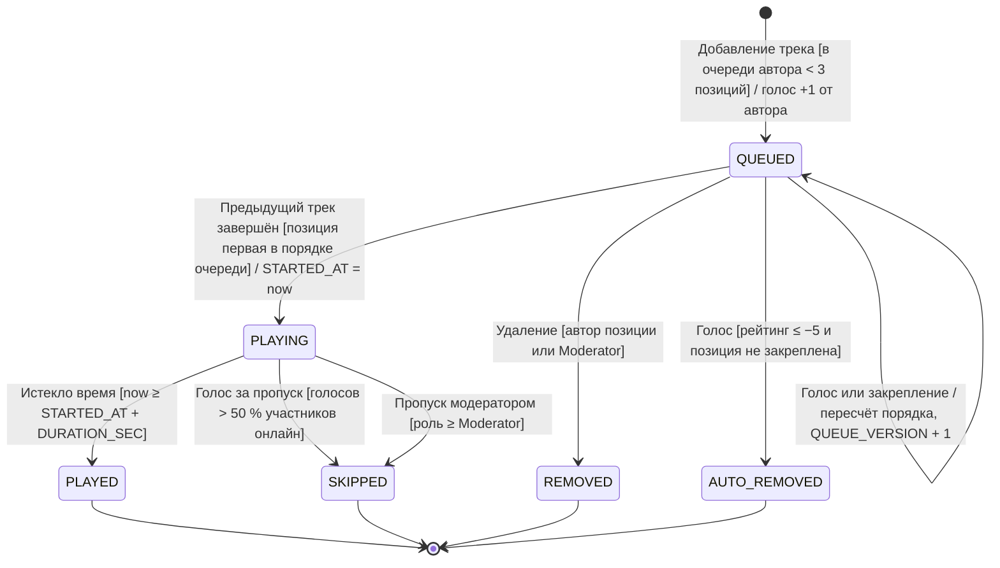
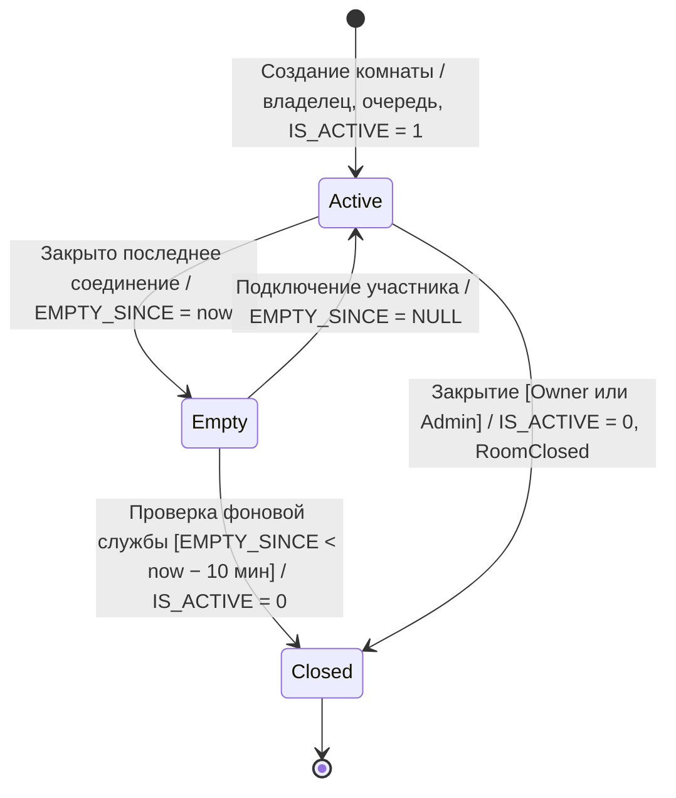
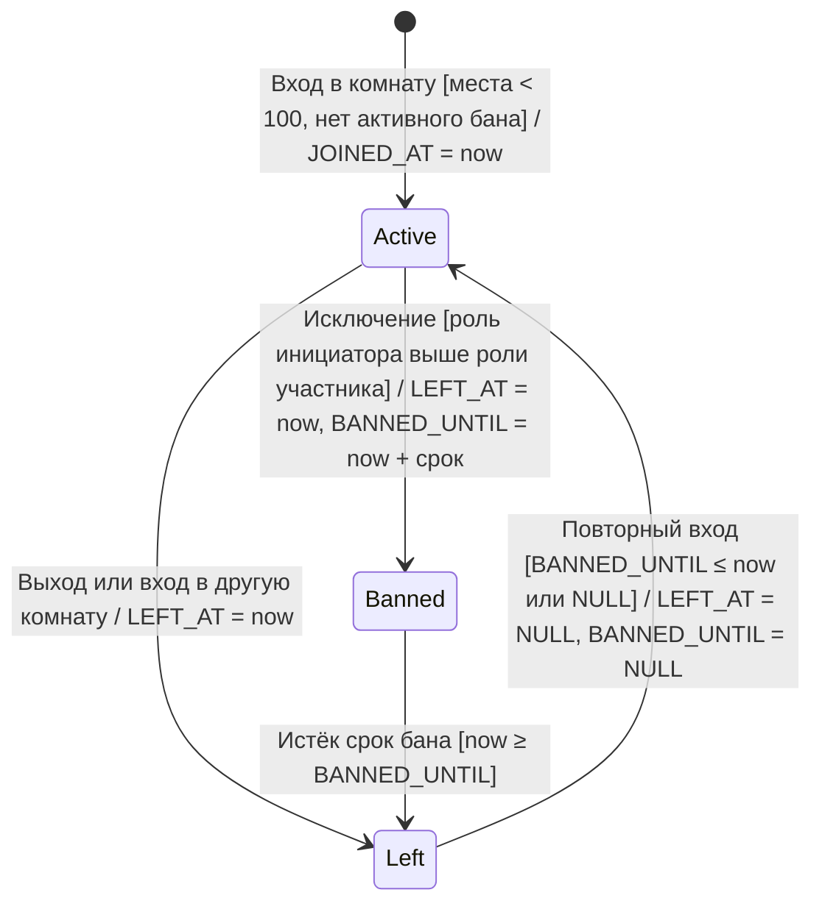

# Диаграммы состояний

Обозначения переходов: `событие [условие] / действие`. Состояния совпадают со значениями колонок в БД ([модель данных](../02-data-model.md)), поэтому каждую диаграмму можно проверить запросом и сценарным тестом.

## 1. Позиция очереди (`PLAYLIST_TRACKS.STATUS`)

Основная сущность с жизненным циклом: трек, добавленный в очередь комнаты.

| Из | В | Событие | Условие | Действие | Требования |
|---|---|---|---|---|---|
| — (начальное) | QUEUED | Добавление трека в очередь | Участник комнаты; у автора < 3 позиций в `QUEUED`/`PLAYING` | Вставка позиции и голоса +1 автора в одной транзакции; рассылка `QueueUpdated` | UC-07, BR-VOTE-04, BR-ROOM-04 |
| QUEUED | QUEUED | Голос, закрепление, открепление | — | Пересчёт порядка, `QUEUE_VERSION + 1`, рассылка | UC-08, UC-18, FR-RT-03 |
| QUEUED | PLAYING | Завершение предыдущего трека | Позиция первая по порядку (закрепление → рейтинг → время добавления) | `STARTED_AT = now`; рассылка `PlaybackChanged` | UC-16, FR-RT-05 |
| QUEUED | REMOVED | Удаление позиции | Инициатор — автор позиции или Moderator+ | Голоса за позицию сохраняются для истории | UC-09 |
| QUEUED | AUTO_REMOVED | Голос «против» | Рейтинг ≤ −5, позиция не закреплена | Рассылка `QueueUpdated` | BR-VOTE-05 |
| PLAYING | PLAYED | Окончание трека | `now ≥ STARTED_AT + DURATION_SEC` | Следующая позиция переходит в `PLAYING` | UC-16, BR-TRK-06 |
| PLAYING | SKIPPED | Голос за пропуск | Голосов строго больше половины участников онлайн | Следующая позиция переходит в `PLAYING` | UC-17, BR-VOTE-07 |
| PLAYING | SKIPPED | Пропуск модератором | Роль Moderator или Owner | То же | UC-09 |

**Начальное состояние:** `QUEUED`. **Конечные состояния:** `PLAYED`, `SKIPPED`, `REMOVED`, `AUTO_REMOVED` — из них переходов нет.

**Инварианты, проверяемые БД** ([тесты ограничений](../../db/tests/constraints_test.sql)):
- в одной очереди не более одной позиции `PLAYING` (`UX_PLAYLIST_TRACKS_PLAYING`);
- `STARTED_AT` заполнено ровно у `PLAYING`, `PLAYED`, `SKIPPED` (`CK_PLAYLIST_TRACKS_STARTED`).

Допустимость самих переходов (например, запрет `PLAYED → QUEUED`) проверяется в доменном слое: ограничение `CHECK` видит только новое значение строки.

## 2. Комната (`ROOMS.IS_ACTIVE`, `ROOMS.EMPTY_SINCE`)

| Состояние | Значения в БД |
|---|---|
| Active | `IS_ACTIVE = 1`, `EMPTY_SINCE IS NULL` |
| Empty | `IS_ACTIVE = 1`, `EMPTY_SINCE IS NOT NULL` |
| Closed | `IS_ACTIVE = 0` |

Требования: UC-05, UC-11, BR-ROOM-07.

## 3. Участник комнаты (`ROOM_MEMBERS`)

| Состояние | Значения в БД |
|---|---|
| Active | `LEFT_AT IS NULL` |
| Left | `LEFT_AT IS NOT NULL`, бана нет или он истёк |
| Banned | `LEFT_AT IS NOT NULL`, `BANNED_UNTIL > now` |

Конечного состояния нет: история участия хранится постоянно, строка не удаляется. Требования: UC-06, UC-10, BR-ROOM-03, BR-ROOM-06, BR-ROOM-08.
