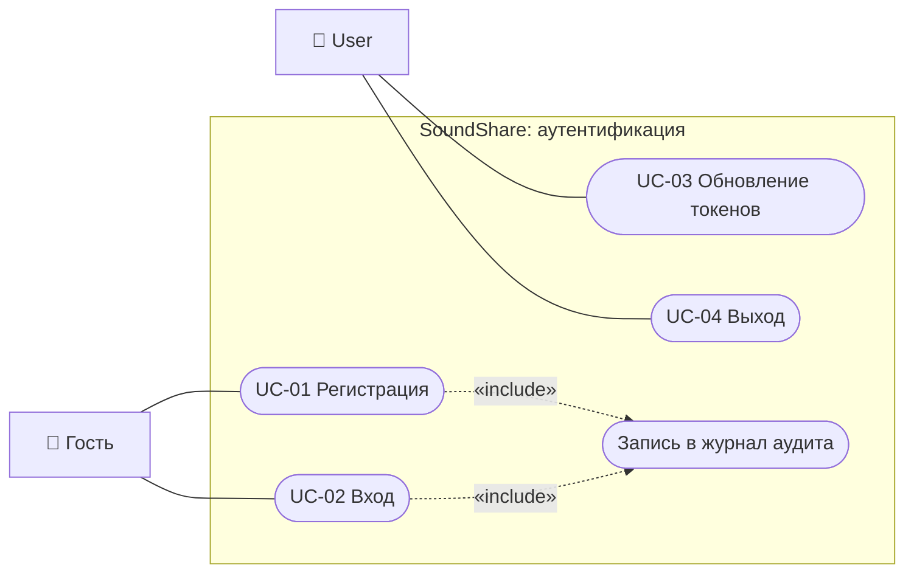
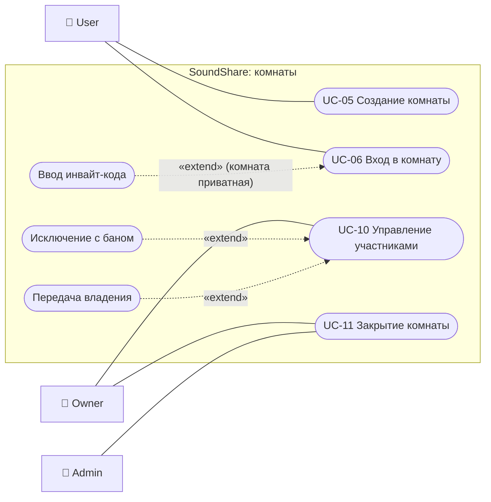
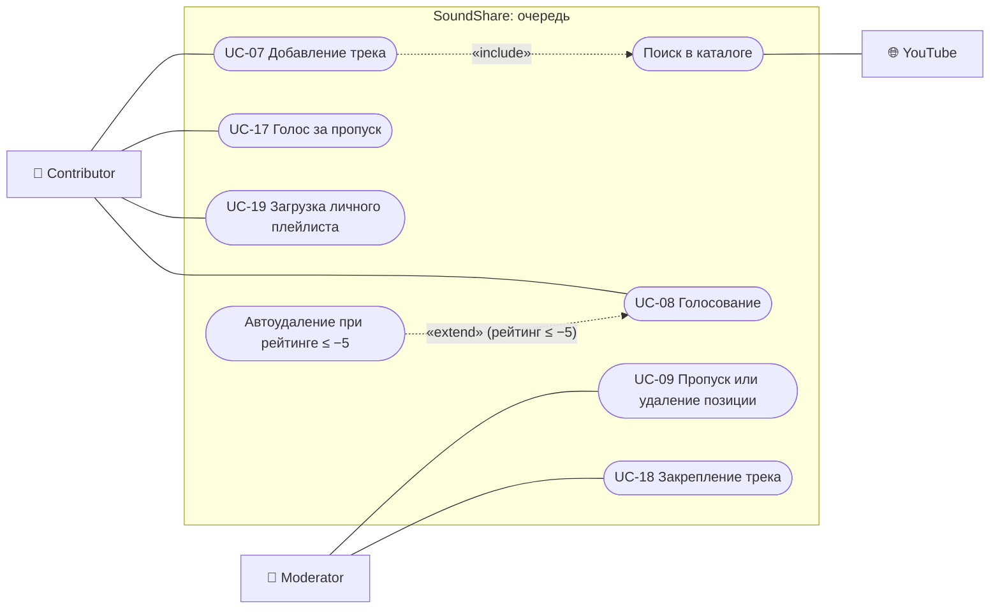
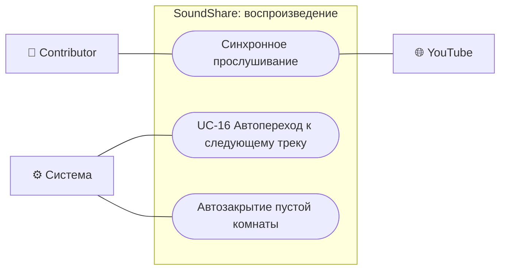
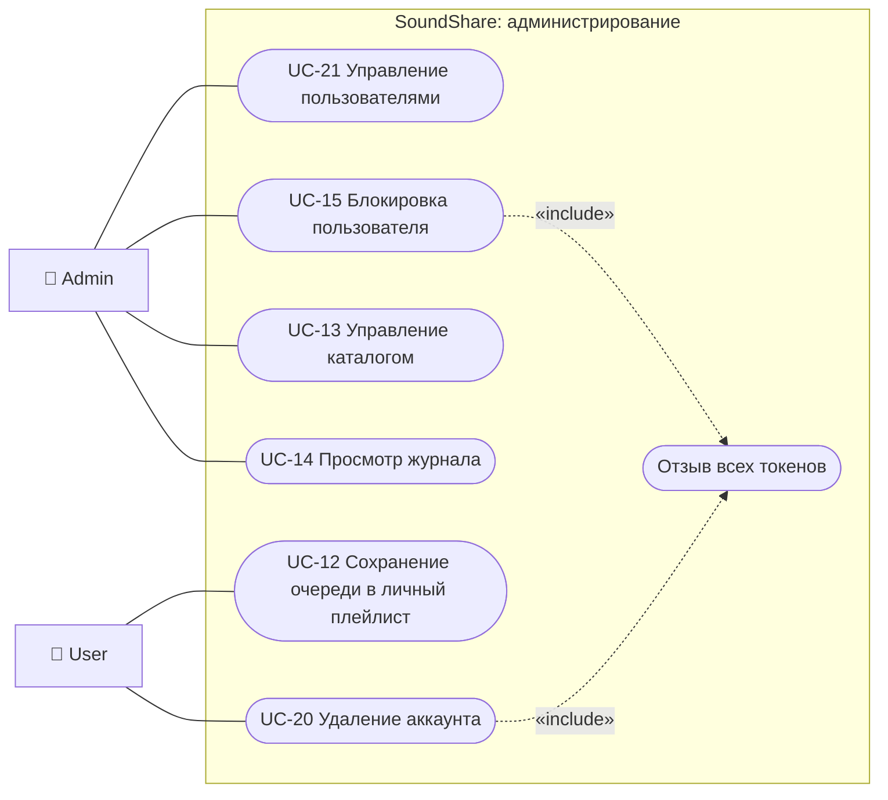

# Пользовательские требования и варианты использования

Подробные сценарии UC-01…UC-21 (предусловия, основной поток, результат) — в [техническом задании](../01-technical-specification.md), раздел 3.4. Здесь — пользовательские требования и диаграммы вариантов использования.

## 1. Акторы

| Актор | Описание |
|---|---|
| Гость | Неаутентифицированный посетитель |
| User | Зарегистрированный пользователь платформы |
| Contributor | Участник комнаты: добавляет треки, голосует |
| Moderator | Участник комнаты с правами модерации очереди и участников |
| Owner | Владелец комнаты |
| Admin | Администратор платформы |
| Система | Фоновые службы SoundShare |
| YouTube | Внешний сервис метаданных и воспроизведения |

Contributor, Moderator и Owner — роли пользователя (User) внутри конкретной комнаты; права наследуются: Owner ⊃ Moderator ⊃ Contributor.

## 2. Пользовательские требования

| ID | Требование | Варианты использования | Функциональные требования |
|---|---|---|---|
| UR-01 | Как гость, я хочу зарегистрироваться и войти, чтобы пользоваться комнатами; сессия должна сохраняться без повторного ввода пароля в течение 7 дней | UC-01, UC-02, UC-03, UC-04 | FR-AUTH-01…11 |
| UR-02 | Как пользователь, я хочу создать комнату или войти в существующую (публичную или по инвайт-коду), чтобы слушать музыку вместе с другими | UC-05, UC-06, UC-11 | FR-ROOM-01…03 |
| UR-03 | Как участник комнаты, я хочу добавлять треки и голосовать за них, чтобы очередь отражала предпочтения группы | UC-07, UC-08, UC-17, UC-19 | FR-RT-03, FR-RT-07, FR-CAT-01, FR-INT-01, FR-INT-02 |
| UR-04 | Как участник комнаты, я хочу слышать тот же момент трека, что и остальные, и видеть изменения очереди сразу, без обновления страницы | UC-06, UC-16 | FR-RT-01, FR-RT-02, FR-RT-04…06 |
| UR-05 | Как модератор или владелец, я хочу закреплять, пропускать и удалять треки и исключать нарушителей, чтобы поддерживать порядок в комнате | UC-09, UC-10, UC-18 | BR-VOTE-08, BR-ROOM-05, BR-ROOM-08 |
| UR-06 | Как администратор, я хочу управлять пользователями и каталогом, чтобы поддерживать платформу | UC-13, UC-15, UC-21 | FR-USR-01…04 |
| UR-07 | Как администратор, я хочу видеть журнал действий с фильтрами, чтобы расследовать инциденты | UC-14 | FR-AUD-01…09 |
| UR-08 | Как пользователь, я хочу сохранять очередь в личный плейлист и удалить свой аккаунт вместе с персональными данными | UC-12, UC-20 | FR-USR-05, BR-ACC-01 |

## 3. Диаграммы вариантов использования

Обозначения: прямоугольник — граница системы, овал — вариант использования, сплошная линия — участие актора, пунктир «include» — обязательное включение, «extend» — расширение при условии.

### 3.1 Аутентификация

### 3.2 Комнаты и участники

### 3.3 Очередь и голосование

### 3.4 Воспроизведение

### 3.5 Администрирование и личные данные

