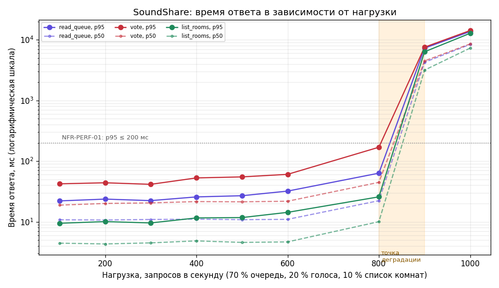

# Отчёт о нагрузочном тестировании (задание 5)

План — [load-test-plan.md](load-test-plan.md). Дата — 20.10.2026. Инструмент — NBomber 6.7 (`tests/SoundShare.LoadTests`), API в конфигурации Release, Oracle Database 23ai Free в Docker, генератор нагрузки на той же машине (28 логических ядер, 32 ГБ ОЗУ). Перед прогонами демо-данные пересоздавались; тест сам создавал 60 пользователей, комнату и 11 позиций очереди.

## 1. Итоги

| Прогон | Нагрузка | Запросов | Ошибок | p95, мс | Вывод |
|---|---|---:|---:|---|---|
| Базовый | 1 пользователь, 30 с | 3 478 (116 RPS) | 0 | очередь 10,6 | Эталон времени ответа без конкуренции |
| Нагрузочный, до исправления | 100 RPS, 60 с | 6 000 | **223 (3,7 %)** — 18,6 % голосов → 409 | очередь 20,1; голос 35,9 | Найден дефект DEF-024 |
| Нагрузочный, после исправления | 100 RPS, 60 с | 6 000 | 0 | очередь 21,1; голос 39,3; список 8,5 | **NFR-PERF-01 выполнено** (p95 ≤ 200 мс при 100 RPS) |
| Стрессовый | ступени 100 → 1000 RPS по 30 с | 93 000 | 0 | на верхних ступенях — секунды | Система не отказывает, но после ~850 RPS запросы встают в очередь |
| Серия стабильных прогонов | 100–1000 RPS по 20 с | — | 0 | см. таблицу 2 | Точка деградации между 800 и 900 RPS |

Подробные HTML-отчёты NBomber: [базовый](load/nbomber-baseline.html), [нагрузочный до исправления](load/nbomber-load-before-fix.html), [нагрузочный](load/nbomber-load.html), [стрессовый](load/nbomber-stress.html), [600 RPS](load/nbomber-rate-600.html), [900 RPS](load/nbomber-rate-900.html).

## 2. Время ответа в зависимости от нагрузки

| RPS всего | Очередь p50 / p95, мс | Голос p50 / p95, мс | Список комнат p50 / p95, мс | Ошибок |
|---:|---|---|---|---:|
| 100 | 10.8 / 22.08 | 18.8 / 42.24 | 4.44 / 9.45 | 0 |
| 200 | 10.68 / 23.65 | 20.05 / 43.94 | 4.31 / 10.06 | 0 |
| 300 | 10.91 / 22.32 | 20.48 / 41.44 | 4.49 / 9.57 | 0 |
| 400 | 11.05 / 25.7 | 21.52 / 52.83 | 4.84 / 11.57 | 0 |
| 500 | 10.82 / 26.88 | 21.34 / 54.94 | 4.57 / 11.73 | 0 |
| 600 | 10.97 / 32.05 | 21.82 / 60.54 | 4.66 / 14.3 | 0 |
| 800 | 22.27 / 63.3 | 44.7 / 169.34 | 10.04 / 25.76 | 0 |
| 900 | 4259.84 / 7278.59 | 4485.12 / 7548.93 | 3162.11 / 6340.61 | 0 |
| 1000 | 8396.8 / 13697 | 8552.45 / 14221.3 | 7303.17 / 12804.1 | 0 |

- До 600 RPS время ответа почти не меняется (p95 очереди 22–32 мс).
- На 800 RPS — первый рост: p95 голосования 169 мс, в пределах NFR.
- На 900 RPS — **деградация**: медиана прыгает до 4 с, все сценарии становятся медленными одновременно; ошибок нет, запросы ждут в очереди.
- После снятия нагрузки время ответа сразу вернулось к базовому (контрольный прогон на 100 RPS сразу после 1000 RPS — p95 очереди 28 мс, ошибок 0): система восстанавливается без перезапуска.

## 3. Найденный дефект: потеря голосов при конкуренции

При 20 голосах в секунду в одной комнате 18,6 % голосов получали `409 Conflict` (`concurrency-conflict`), и в ответе раскрывался текст исключения EF Core. Причина: каждый голос увеличивал `PLAYLISTS.QUEUE_VERSION` через отслеживаемую сущность с маркером оптимистичной конкуренции — параллельные голоса в одной комнате конфликтовали на одной строке. Исправление: версия очереди увеличивается атомарным `UPDATE … SET QUEUE_VERSION = QUEUE_VERSION + 1`, порядок голосов по-прежнему защищает `SELECT … FOR UPDATE` строки позиции; текст ошибки конфликта заменён нейтральным. После исправления — 0 ошибок на всех уровнях нагрузки (DEF-024).

## 4. Гипотеза об узком месте

Во время прогона на 900 RPS:

| Ресурс | Загрузка |
|---|---|
| Контейнер Oracle | 241–269 % CPU (≈ 2,5 ядра) |
| Процесс API | 13–15 % от 28 ядер (≈ 4 ядра), 96 потоков |
| Ошибки пула соединений, таймауты | нет |

**Узкое место — база данных.** Oracle Database Free ограничена двумя потоками CPU; к 850–900 RPS она выбирает этот лимит, и запросы начинают ждать. API загружен слабо, сеть и пул соединений ошибок не дают. Вклад вносит и число SQL-операторов на запрос: `GET /queue` проверяет комнату и членство, читает очередь и вычисляет рейтинг агрегатом по `TRACK_VOTES`; голос выполняет блокировку строки, MERGE голоса, пересчёт рейтинга и увеличение версии.

Что улучшит пропускную способность (по убыванию эффекта):

1. Кэшировать состояние очереди в памяти API и инвалидировать по `QUEUE_VERSION` — чтения (70 % нагрузки) перестанут доходить до БД.
2. Индексы под запросы очереди и голосов — проверено на этапе 7 МДиСУБД ([отчёт об индексах](../07-index-report.md)).
3. Хранить денормализованный рейтинг позиции, обновляемый в той же транзакции, что и голос, вместо `SUM` при каждом чтении.
4. Для промышленной нагрузки — редакция Oracle без ограничения CPU.

## 5. Выводы

- NFR-PERF-01 (p95 ≤ 200 мс при 100 RPS) выполнено с запасом: p95 ≤ 40 мс, ошибок 0.
- Рабочий запас — до 800 RPS (в 8 раз выше целевой нагрузки) без нарушения NFR.
- Точка деградации — 850–900 RPS, причина — лимит CPU Oracle Free.
- Нагрузочный тест нашёл дефект конкурентного доступа, который не проявлялся ни в автотестах, ни в ручном тестировании.
